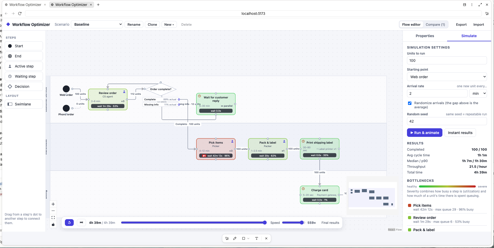

# Workflow Optimizer Prototype

**Problem:** Operational efficiency is a key business need - it impacts business profitability as well as its ability to maintain the level of service expected by its customers.  Yet, no tools exist that allow operations to map out a multi-functional process, identify the bottlenecks, and conduct hypothetical experiments to answer the question: "what happens to the workflow if one bottleneck is removed - what's the next bottleneck?"

**Why is it a problem:** operational efficiency teams need to make informed decisions to prioritize engineering efforts in a way that addresses high priority problems without creating additional bottlenecks.  At present, efforts are running blind and many operational changes become reactive rather than calculated and planned. 

**How do we solve it:** This applicaiton enables users to map the workflow over swimlanes and wroflow branches, assign time ranges to steps, and run simulations to identify bottlenecks and their severity as volume grows.

I want you to design a prototype of an applicaiton described to solve the problem above.  The applicaiton should have several steps:
## Building the Process Flow
It should allow the user to create swimlanes and name / rename them as needed. The user can add or remove swimlanes as needed.  The user should be warned about removing a swimlane if it has steps.  If a swimlane with steps is removed, the steps should not be removed, but should stay outside of the swimlanes.  The user should be able to create standard UML diagram steps to describe the workflow.  Each step shall have a name, description, and actor fields.  These fields are optional, so if a user does not fill them in, they are allowed to proceed.  Each step type shall have additional parameters:
1. Special reserved steps: start and end.  These are special process indicators.  The process can have multiple starting points and multiple end points.
2. Process steps shall have a time range (in seconds or minutes as specified by the user).  Process can be marked as active - i.e. requiring action from a user, or waiting - i.e. no action is required, but users have to wait.  Waiting processes may have machines assigned to show the automation.  Waiting processes shall have a visual indicator (clock) in the top left corner to show that it's a wait process.  User action processes shall have a visual indication of a small person icon in the top right corner to indicate that it's a person action.   
3. Decision steps should have outcomes and outcome triggers.  The number of outcomes in decisions shall not be limited.  The user shall be able to assign % likelihood of outcome or set up rules like that are informed by upstream process.  Example: worfklow origination = step A or step B.
4. Connectors will indicate the flow of the steps and are shaped as arrows going from one of the process or decision steps to the other.  When simulations run, they will use connectors to identify the next step.

## Running a simulation
The user can run a simulation at any point of running the process flow.  When starting a simulation, the user can indicate how many "units" they want to run through the process flow and the starting point (if there are multiple, the user should select one).  The simulation should start at the starting point and go through each step, pausing at each step for the amount of seconds indicated for the step.  The time range should be treated as standard distribution - i.e. most of the volume in the process flow should take medean time, with outliers at either end of the time range.  

## Prototype
More coming soon!

_Screenshot after simulation ran and identified the bottlenecks_
